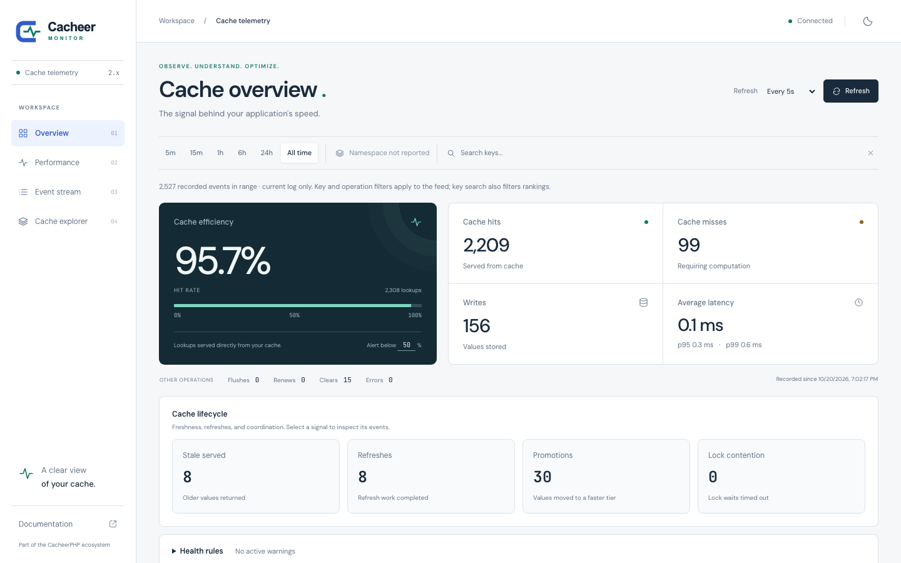
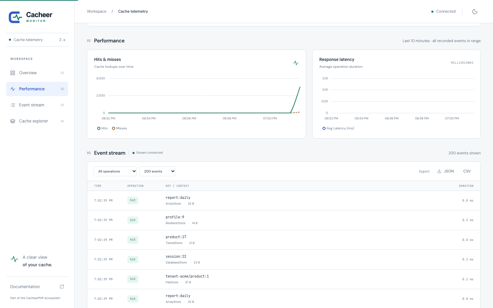
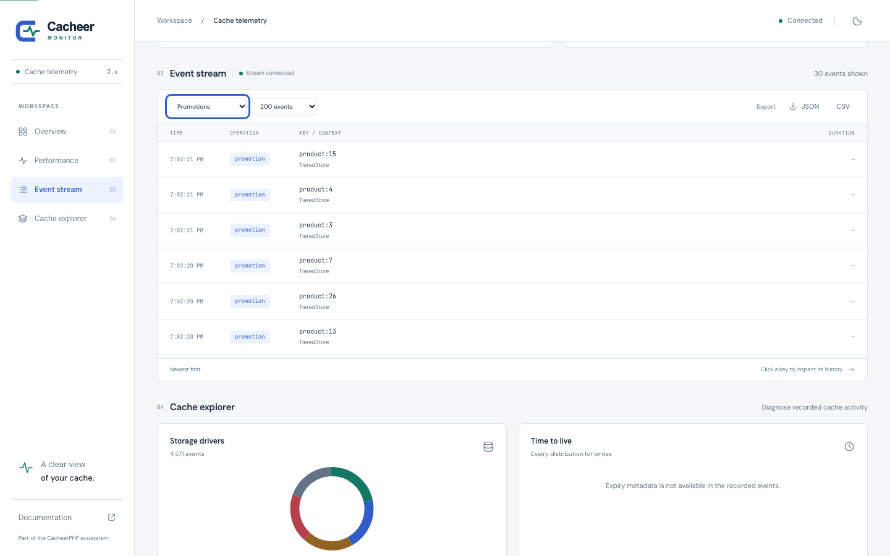
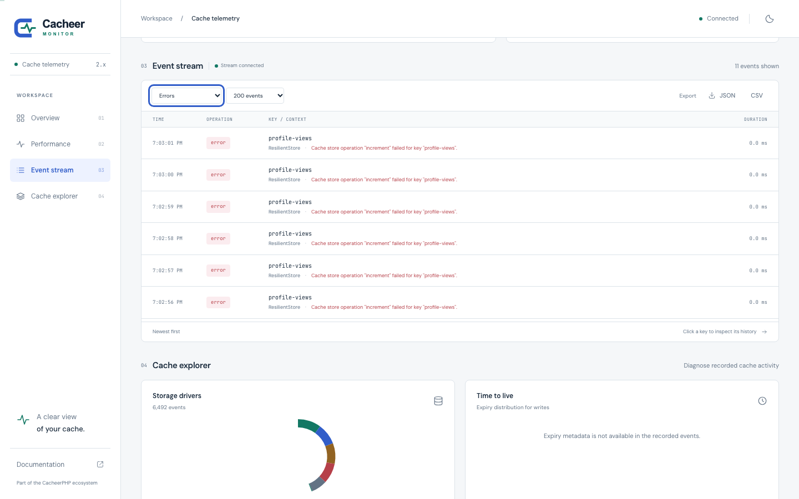
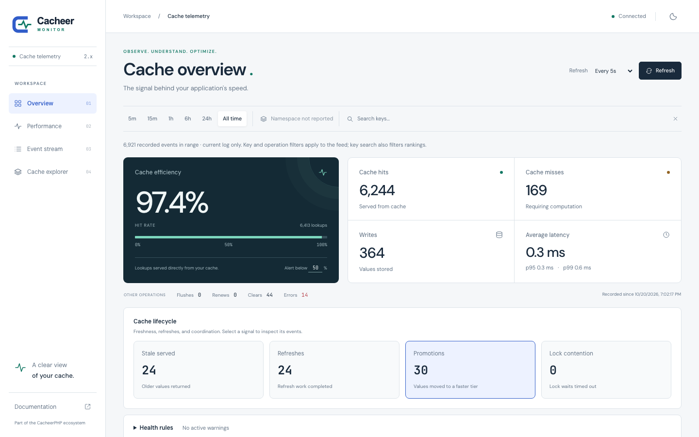
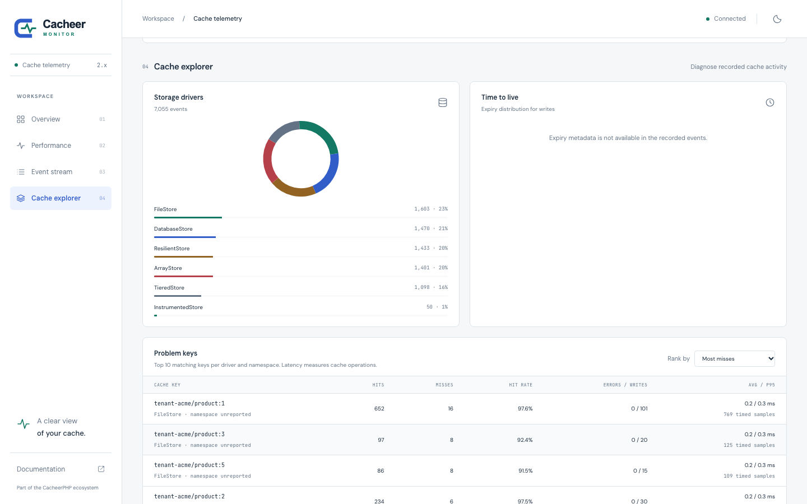
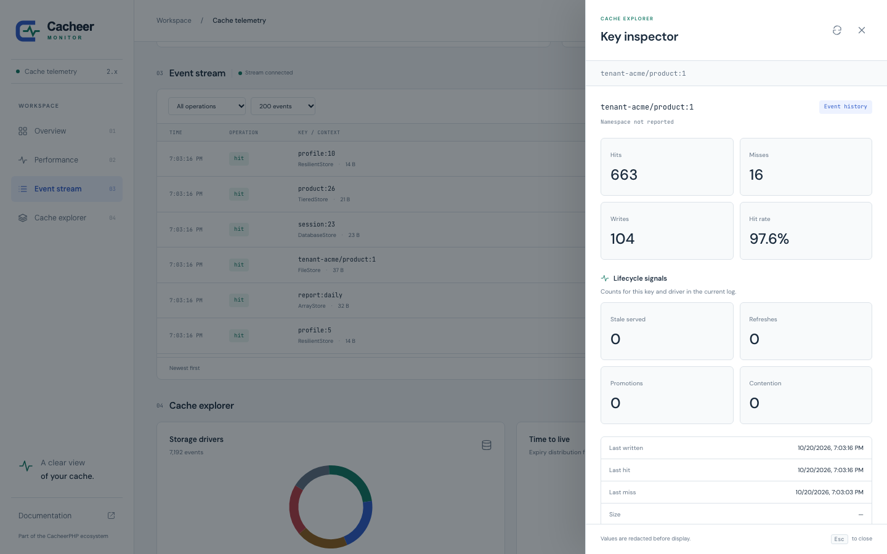

# CacheerPHP evidence

Reproducible measurements and demonstrations behind the claims made for
CacheerPHP 6. Everything here runs real stores against real services on one
machine, and records what it ran on. None of it is part of the Composer
package (`evidence/` is export-ignored), and none of it runs in CI.

| Evidence | Script | Result |
|---|---|---|
| Tiered caching benchmark | [`bench/tiered.php`](bench/tiered.php) | [mixed workload](results/tiered-benchmark.md), [read-only](results/tiered-benchmark-read-only.md) |
| Redis outage demonstration | [`outage/redis-outage.php`](outage/redis-outage.php) | [timeline](results/redis-outage.md) |
| Cacheer Monitor walkthrough | [`monitor/record.sh`](monitor/record.sh) | [screenshots](monitor/media/) and a silent video |

## Reproduce

Requirements: PHP 8.3+ with `pdo_sqlite` and `posix`, Composer, `redis-server`
on `PATH`, and — for the walkthrough only — Node.js with npm.

```bash
cd evidence
composer install                      # the library from this checkout, plus Predis and cacheerphp/monitor

php bench/tiered.php                  # ~1 minute; writes results/tiered-benchmark.{json,md}
php bench/tiered.php --write-ratio=0 --out=tiered-benchmark-read-only
php outage/redis-outage.php           # ~3 seconds; writes results/redis-outage.md
monitor/record.sh                     # ~80 seconds; writes monitor/media/
```

Each script starts its **own** `redis-server` on `127.0.0.1:6391` with
persistence off and stops it afterwards, so a Redis already on the machine is
never read or touched. Temporary files go to the system temp directory and are
removed. The benchmark and outage scripts switch Monitor's automatic listener
off (`CACHEER_MONITOR_AUTO_REGISTER=false`) so they measure the cache, not the
monitor; the walkthrough keeps it on.

## Test machine

The committed results were produced on:

| | |
|---|---|
| Machine | Apple M4, 10 cores, 16 GB |
| OS | macOS 27.0 (Darwin 27.0.0, arm64) |
| PHP | 8.5.11 CLI, OPcache and JIT off (the CLI defaults) |
| Library | `silviooosilva/cacheer-php` 6.x-dev @ 966e5ae |
| Redis | 8.2.0, loopback (`127.0.0.1`), client Predis 2.4.1 |
| Monitor | `cacheerphp/monitor` 2.0.0 (Packagist), dashboard on PHP's built-in server |
| Browser | Playwright Chromium, headless, 1440 × 900 |

Every result file repeats the environment it was measured on.

## 1. Tiered caching benchmark

**Question:** what does an in-process L1 (`TieredStore`: `ArrayStore` in front
of a shared store) save on a read-heavy workload?

**Method.**

- Four configurations: Redis alone, Redis behind an `ArrayStore` L1, an SQLite
  file (`DatabaseStore`) alone, and the SQLite file behind the same L1.
- 1,000 keys holding 1 KB values are written straight into L2 before each run,
  so L1 always starts **cold** and has to earn every hit.
- One seeded operation sequence (seed 42) replayed by every configuration:
  50,000 operations, keys drawn from a Zipf distribution (s = 1.0), 5% writes
  in the mixed workload and none in the read-only one.
- 5 runs per configuration; the tables report the median and the min–max range
  of throughput, and the median of each run's p50/p95/p99 latency. Latency is
  measured per operation with `hrtime()` and includes PHP and Predis overhead.
- **L2 calls** counts the calls that reached the shared store (a counting
  wrapper around L2). For Redis it is cross-checked against the server's own
  `total_commands_processed`; the two agree exactly.

**Results — mixed workload (95% reads, 5% writes).**

| Backend | Shape | ops/s (min–max) | p50 µs | p95 µs | p99 µs | L2 calls | vs. alone |
|---|---|---|---|---|---|---|---|
| Redis | alone | 10,594 (9,952–11,250) | 89.0 | 111.9 | 228.1 | 50,000 | 1.00× |
| Redis | tiered (Array L1) | 126,085 (116,549–133,757) | 1.2 | 89.4 | 98.1 | 3,436 | 11.90× |
| SQLite file | alone | 16,624 (14,622–28,481) | 9.0 | 56.8 | 381.4 | 50,000 | 1.00× |
| SQLite file | tiered (Array L1) | 21,064 (20,523–52,329) | 1.1 | 35.3 | 361.9 | 3,436 | 1.27× |

**Results — read-only.**

| Backend | Shape | ops/s (min–max) | p50 µs | p95 µs | p99 µs | L2 calls | vs. alone |
|---|---|---|---|---|---|---|---|
| Redis | alone | 11,171 (10,520–11,221) | 88.0 | 98.4 | 126.9 | 50,000 | 1.00× |
| Redis | tiered (Array L1) | 336,997 (333,952–339,979) | 1.0 | 1.5 | 91.5 | 1,001 | 30.17× |
| SQLite file | alone | 113,560 (112,813–113,794) | 8.6 | 9.4 | 11.0 | 50,000 | 1.00× |
| SQLite file | tiered (Array L1) | 763,910 (752,436–769,373) | 1.0 | 1.3 | 11.1 | 1,001 | 6.73× |

**Reading the results.**

- The transferable number is **L2 calls**: with an L1, 50,000 reads reached
  Redis 1,001 times — one first read per key plus one generation check. On a
  remote Redis each avoided call also saves a network round trip, which this
  loopback setup does not include, so the gain grows with real latency.
- Writes are write-through: every write still reaches L2 (that is where the
  mixed workload's 3,436 calls come from — about 2,500 writes, about 900 first
  reads, and generation checks). An L1 helps reads, not writes.
- The SQLite mixed workload is dominated by the disk sync behind each write,
  which an L1 cannot avoid; its wide ranges come from that I/O, so treat its
  1.27× as "write-bound", not as a stable figure.
- Tail latency (p99) stays close to the L2's, because the slowest operations
  are the cold reads and writes that go to L2 in both shapes.

## 2. Redis outage demonstration

**Question:** what does an application see when Redis goes away and comes back
behind a `ResilientStore`?

**Method.** A `ResilientStore` with a Redis primary (Predis, 0.25 s connect/read
timeout) and a `FileStore` fallback; the breaker opens after 3 failures and
probes again after 2 s. The script then takes the real Redis process through:

1. **healthy** — normal reads and writes, a counter, a lock;
2. **frozen** — `SIGSTOP`: Redis keeps its data and accepts connections but
   never answers, the most realistic kind of outage (clients wait for timeouts);
3. **recovered** — `SIGCONT`, after the 2 s recovery window;
4. **killed** — `SIGKILL`: connections are refused outright.

Every request is logged with its latency, result, and the breaker's state.

**Results** ([full timeline](results/redis-outage.md)):

- **Detection.** The first three requests against the frozen Redis each waited
  the 0.25 s timeout (~252 ms) while still returning `'Ada'` from the warm
  fallback. Then the breaker opened and every request took ~0.1 ms: no request
  waits on a dead backend once the breaker is open.
- **Fail-closed where correctness needs it.** During the outage
  `increment('logins')` was refused (`StoreOperationFailedException`) instead of
  counting on a second, divergent counter, and `lock('nightly')->acquire()`
  returned `false` in 0.0 ms instead of waiting or handing out a lock on the
  fallback. `remember()` kept working — it computed the value without
  single-flight.
- **No resurrection on recovery.** `session:9` was deleted during the outage;
  after recovery it stayed a miss rather than reappearing from the primary's old
  copy. `user:1`, changed during the outage, was invalidated on the primary
  instead of serving the pre-outage `'Ada'`. The counter resumed on the primary
  (`2`).
- **Refused connections.** With the process killed, failures were detected in
  ~0.1 ms each (no timeout to wait for), and the breaker opened after three.

## 3. Cacheer Monitor walkthrough

**What it shows.** [`monitor/traffic.php`](monitor/traffic.php) generates 75
seconds of real, mixed traffic through five caches — a scoped file catalog
(`remember`, renewals, tag flushes), SQLite sessions, a tiered Redis cache whose
L2 another worker already filled (so reads promote), a `flexible()` report
refreshed through `AfterResponseDeferredExecutor`, and a resilient Redis cache
whose primary is frozen from about 34 s to 45 s. Monitor records it through its
automatic listener; values are not captured, only metadata.
[`monitor/record.mjs`](monitor/record.mjs) drives the dashboard with Playwright
while the traffic runs and saves one screenshot per stop plus a silent 68-second
video.

| | Stop | What to point out |
|---|---|---|
|  | [Overview](monitor/media/01-overview.png) | Hit rate, hits/misses/writes, average and tail latency, lifecycle signals |
|  | [Performance](monitor/media/02-performance.png) | Hits vs. misses and latency over time |
|  | [Promotions](monitor/media/03-promotions.png) | Tiered reads moving values into L1 (`TieredStore`) |
|  | [Outage](monitor/media/04-outage-errors.png) | The resilient counter failing closed while Redis is frozen |
|  | [After the outage](monitor/media/05-overview-after-outage.png) | Errors recorded, hit rate unaffected |
|  | [Cache explorer](monitor/media/06-cache-explorer.png) | Activity per storage driver and problem keys |
|  | [Key inspector](monitor/media/07-key-inspector.png) | One key's hits, misses, writes, and timestamps; values redacted |

To record a narrated version, run `monitor/record.sh` once to see the timing,
then record your screen while it runs again, following the stops above.

The video (`monitor/media/walkthrough.webm`, about 9 MB) is regenerated by
`record.sh` and kept out of Git to avoid binary churn; publish it with a
release or on the website.

## Limitations

- **One machine, loopback Redis.** No network latency, no contention from other
  processes. Absolute numbers will differ elsewhere; the L2 call counts and the
  relative behavior are what transfer.
- **Single process.** `ArrayStore` L1 is per process, so the benchmark measures
  one worker's view. Cross-worker coherence (generation token, 60 s L1 cap) is
  covered by the test suite, not measured here.
- **PHP CLI defaults.** OPcache and JIT were off; a production FPM worker with
  OPcache would run the PHP side faster, shrinking the in-process latencies.
- **Per-operation timing** adds `hrtime()` overhead to every sample, which
  matters most for the ~1 µs L1 hits.
- **SQLite numbers are I/O-bound** and vary with the disk; the mixed SQLite
  ranges are wide for that reason.
- **The outage demo uses real time** (timeouts, recovery window), so its
  latencies vary by a few milliseconds between runs; the sequence of outcomes
  does not.
- **What Monitor 2.0 does not show yet,** observed during the walkthrough:
  - read failovers inside a `ResilientStore` are invisible — instrumentation
    wraps the resilient cache from outside, where those reads succeeded — so
    only the fail-closed counter appears as an error;
  - "Renews" and "Flushes" stay at 0: v6 reports `touch()` as a write and a tag
    flush as a prune, which the dashboard counts under other names;
  - "Namespace not reported": v6 events carry the scope only inside the key
    (`tenant-acme/product:1`);
  - the TTL panel is empty because v6 events do not carry expiry metadata.
- **Miss counts for `remember()`.** A cold `remember()` on a store that can lock
  reads twice (before and after taking the single-flight lock), and both reads
  are recorded as misses, so the dashboard's miss count overstates computations
  for `remember()`-heavy traffic.
- **Recording load.** The walkthrough's headless browser runs on the same
  machine as the traffic generator and competes for CPU (about 1,400 traffic
  iterations while recording against about 2,100 without), so its dashboard
  numbers are illustrative, not a measurement.
